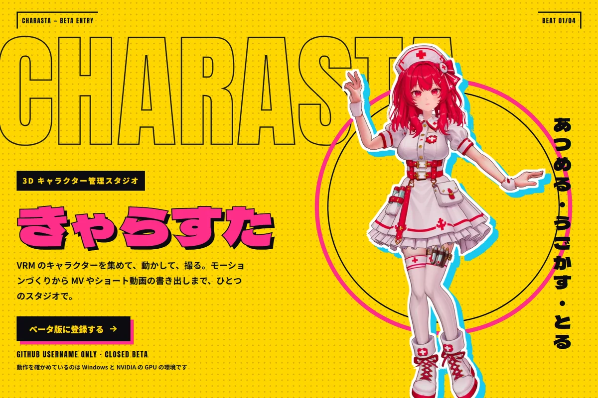
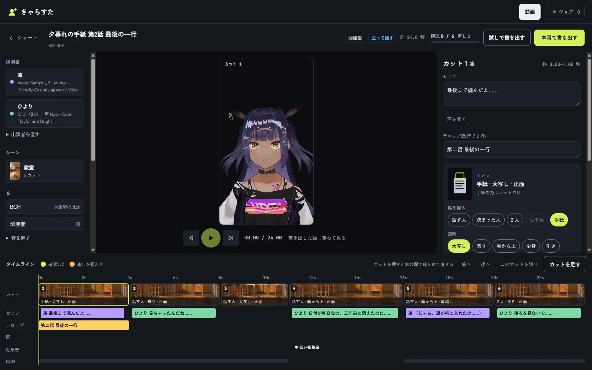
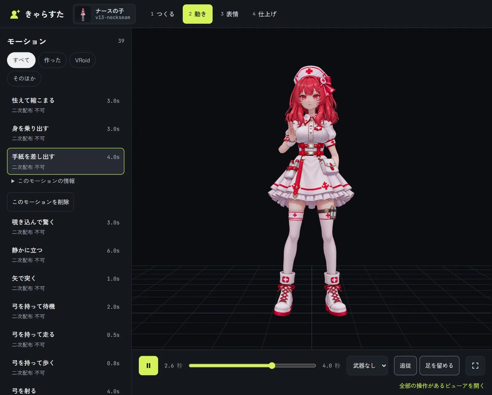
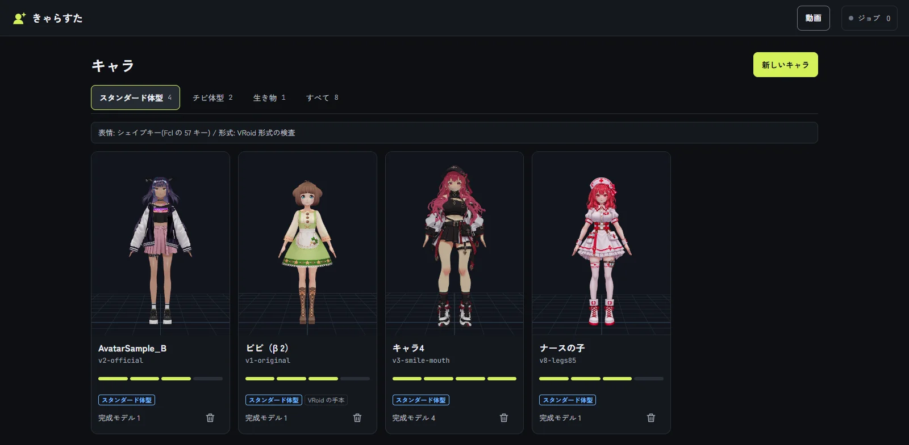

# きゃらすた(Character Studio)

[English](README.md) | 日本語




-19c8f0)


きゃらくるなどで作った VRM のキャラを集めて、表情と声を作り、モーションをつけて動画にする、自分のパソコンで動かす Web アプリです。サーバーは `127.0.0.1` だけで待ち受け、外には公開しません。

- キャラと版の一覧、ビューア、撮影(サムネイル、角度、表情、リップシンク)。キャラの作り方はきゃらくる(Tripo Studio)
- セリフと声、表情づくり(Blender を使う)、体型と揺れものの調整(新しい版として保存)
- モーションの取り込み(VRMA)と、動画からのモーションづくり、MotionBricks(任意の機能)
- ステージの一覧と下見。新しいステージはエージェントに依頼して追加する
- ショート動画(対話型)とダンス MV の制作(同梱の `stage-studio/` が Blender で描く)

このキットは、作者の版から機能を絞った簡単なスタジオです(版の種類 `kit`。`docs/edition.md`)。

このキットは無料で使えます。再配布はできません(下の「ライセンス」)。

## 画面

| 対話型のショートを組む | モーションを付ける |
| --- | --- |
|  |  |



不具合や要望は Issue へどうぞ(型を用意しています)。変更の記録は `CHANGELOG.md` にあります。

## 対応 OS

- Windows 10 / 11: 作者が毎日使っている環境です。
- macOS: **ベータ**です。動作の確認がまだ取れていません。動かない所があるかもしれません。既に分かっている動かない機能は下の表のとおりです。

## 必要なもの

| 物 | 内容 | Windows | macOS |
| --- | --- | --- | --- |
| Node.js 22 以上 | サーバーと撮影の道具。`.nvmrc` がある | 必須 | 必須 |
| ffmpeg(ffprobe を含む) | 動画と音の処理。PATH に置く | 必須 | 必須 |
| Python 3 | 画像と音の処理、stage-studio、モーションの道具。`pip install -r requirements.txt` | 必須 | 必須 |
| Blender 5.x | 表情づくり、MV とショートのステージ描画(stage-studio) | 使う機能があれば必須 | 使う機能があれば必須 |

動画の書き出しは、使える GPU のエンコーダーを自動で選びます(NVIDIA の NVENC、macOS の VideoToolbox、なければ CPU の libx264)。`CHARASTA_ENCODER=cpu` で CPU に固定できます。

## 任意の機能

次の機能は、道具を自分で入れて `config.json` にその場所を書いたときだけ使えます。書かないと、その機能は画面で無効になり、理由が出ます(`/api/capabilities` でも確認できます)。

| 機能 | 必要な物 | 設定のキー | Windows | macOS |
| --- | --- | --- | --- | --- |
| MotionBricks(歩き・走りなどのモーション生成) | MotionBricks のリポジトリと、それが動く環境(NVIDIA の GPU が無ければ ONNX Runtime の CPU で動く) | `motionbricksDir` | 使える | 未確認 |
| vrma-pipeline(動画からのモーション生成、MediaPipe) | vrma-pipeline のリポジトリ、URL の動画を取るなら `yt-dlp` | `vrmaPipelineDir` | 使える | 未確認 |
| きゃらくる(キャラの制作) | きゃらくるのアプリ | `charakuruApp`、`charakuruUrl` | 使える | きゃらくる側の対応に従う |
| VOICEVOX(声) | VOICEVOX Engine | `voicevoxDir` | 使える | 未確認 |
| HyperFrames(ショートの文字と演出) | HyperFrames の CLI と Chrome | `hyperframesCli`、`hyperframesBrowser` | 使える | 未確認 |
| Blender の場所を指定したいとき | Blender の実行ファイル | `blender`(または環境変数 `CHARASTA_BLENDER`) | 使える | 未確認 |

MotionBricks のモデル、VRoid Project VRMA Motion Pack はこのキットに入っていません。条件は `THIRD_PARTY_NOTICES.md` にあります。

## インストール

### Windows(PowerShell)

```powershell
npm install
npx playwright install chromium
pip install -r requirements.txt
copy config.example.json config.json
npm start
```

### macOS(ターミナル、ベータ)

```bash
npm install
npx playwright install chromium
pip3 install -r requirements.txt
cp config.example.json config.json
npm start
```

起動したら http://127.0.0.1:8870 を開きます。ポートは `config.json` の `port` で変えられます。`config.json` を作らなくても起動します。

テストは `npm test` です(本物の道具やモデルが要るテストは、環境変数が無ければ飛ばします)。

## データの保管場所

キャラ、モーション、声、撮影の結果は、コードとは別のフォルダ(`libraryDir`)に入ります。起動時に自動で作ります。

| OS | 既定の場所 |
| --- | --- |
| Windows | `%LOCALAPPDATA%\charasta\library` |
| macOS | `~/Library/Application Support/charasta/library` |
| Linux | `~/.local/share/charasta/library` |

変えるときは `config.json` の `libraryDir` を書きます。取り込んだファイルは変更せず、作ったものを足していきます。

## 設定(config.json)

| キー | 意味 | 既定 |
| --- | --- | --- |
| `libraryDir` | 保管場所 | 上の表 |
| `port` | 待ち受けるポート | 8870 |
| `allowedHosts` | 127.0.0.1 のほかに受け付けるホスト名(Tailscale の名前など) | なし |
| `blender` | Blender の実行ファイル | 環境変数 `CHARASTA_BLENDER`、PATH の `blender`、Windows の `Program Files/Blender Foundation`、macOS の `/Applications/Blender.app` の順に探す |
| `charakuruApp`、`charakuruUrl` | きゃらくるのアプリの場所と URL | 場所は未設定、URL は `http://127.0.0.1:8766/` |
| `patchVrm`、`springTune` | 表情づくりが使うスクリプト | 未設定 |
| `motionbricksDir` | MotionBricks のリポジトリ | 未設定 |
| `motionbricksBackend` | MotionBricks の推論。`auto`(TensorRT が動けば TensorRT、動かなければ ONNX Runtime)、`trt`、`onnx` | `auto` |
| `vrmaPipelineDir` | 動画からモーションを作る道具 | 未設定 |
| `stageStudioDir` | MV とショートのステージを描く stage-studio | 同梱の `stage-studio/` |
| `voicevoxDir` | VOICEVOX Engine の場所。127.0.0.1:50021 で動いていればそれを使う | 未設定 |
| `hyperframesCli`、`hyperframesBrowser` | HyperFrames の `cli.js` と Chrome の実体 | 未設定 |
| `env` | ジョブの外部コマンドに足す環境変数 | なし |

値が `null` か空文字のキーは未設定として扱います。環境変数 `CHARASTA_CONFIG` で別の設定ファイルを指せます。ほかの環境変数は `CHARASTA_PYTHON`、`CHARASTA_FFMPEG`、`CHARASTA_FFPROBE`、`CHARASTA_YTDLP`、`CHARASTA_ENCODER`、`CHARASTA_HW_ENCODER` です。

## エージェントに依頼する

画面からの依頼(ショートの直し、新しいステージ、体型と揺れものの直し、表情づくりの絵)と、キャラやモーションの取り込みは、エージェントに進めてもらえます。Codex でも Claude Code でも使えます。このフォルダを作業の場所にして開き、「きゃらすたの依頼を進めて」のように伝えます。エージェントへの手引きは `AGENTS.md`(Claude Code は `CLAUDE.md` から読む)、作業ごとの手順は `skills/` です。画面のボタンの名前は「エージェントに依頼する」です。

## 取り込みと撮影

```
node scripts/new-character.mjs --id chara4 --name キャラ4 --style standard
node scripts/import-version.mjs --char chara4 --id v3 --label "..." --src <path.vrm> --latest
node scripts/import-motion.mjs --id vrma-02 --label 挨拶 --src <path.vrma> --license-json <file>
node tools/thumb.mjs --char chara4 --ver v3
```

画面からも同じことができます。取り込んだモーションや声の権利は、取り込むときに自分で書きます。

## ライセンス

無料で使え、自分の使い方に合わせて改変でき、作った動画や画像は商用でも公開・販売できます。本ソフトウェア自体の再配布、サービスとしての提供はできません。全文は `LICENSE.md` です。第三者の部品と素材の条件は `THIRD_PARTY_NOTICES.md` です。

## 構成

- `AGENTS.md`: エージェント(Codex、Claude Code など)への手引き。`CLAUDE.md` は Claude Code が読む入口で、`AGENTS.md` を読み込むだけ
- `skills/`: エージェントの作業ごとの手順(依頼、取り込み)。`.agents/skills/`(Codex が探す)と `.claude/skills/`(Claude Code が探す)は同じ中身の写し
- `edition.json`: 版の種類(`kit`)。消すと作者の版として動くが、その機能の道具と文書はこのキットに入っていない
- `server.mjs`、`lib/`: サーバー
- `public/`: 画面
- `tools/`、`scripts/`、`studio/`: 撮影、取り込み、表情づくりの道具
- `test/`: テスト
- `docs/`: 機能ごとの仕様(目次は `docs/README.md`)。`docs/adr/` は設計の決めごとの記録
- `stage-studio/`: MV とショートの 3D シーンを Blender で描く道具(`stage-studio/README.md`)
