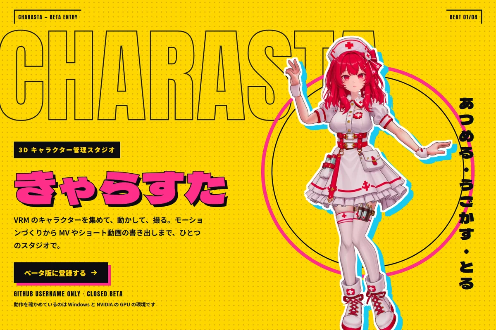
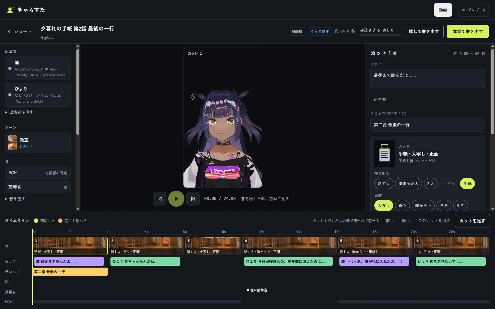
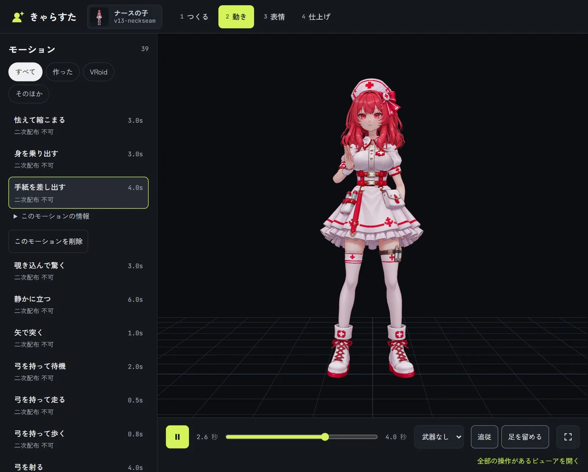
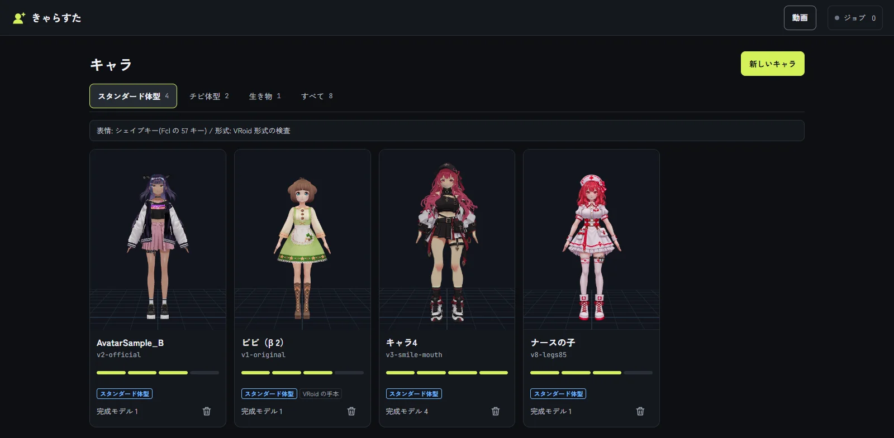

# Charasta (Character Studio)

English | [日本語](README.ja.md)




-19c8f0)


Charasta is a web app that runs on your own computer. Collect the VRM characters you made with Charakuru or other tools, give them expressions and voices, add motion, and turn them into videos. The server listens only on `127.0.0.1` and is never exposed to the outside.

> **Language:** the app screens, the docs under `docs/` and the agent skills are in Japanese for now. This README and the Japanese one ([README.ja.md](README.ja.md)) have the same content.

- Character and version lists, a viewer, and shooting (thumbnails, angles, expressions, lip sync). Characters themselves are made with Charakuru (Tripo Studio)
- Lines and voices, expression making (uses Blender), and body shape and spring-bone tuning (saved as a new version)
- Importing motions (VRMA), making motions from video, and MotionBricks (optional)
- A list of stages with previews. New stages are added by asking an agent
- Making short videos (two-person dialogue) and dance MVs (drawn in Blender by the bundled `stage-studio/`)

This kit is a simpler studio with fewer features than the author's own version (edition `kit`, see `docs/edition.md`).

The kit is free to use. You may not redistribute it (see "License" below).

## Screens

| Building a dialogue short | Adding motion |
| --- | --- |
|  |  |



Please report bugs and requests in Issues (there are templates). Changes are recorded in `CHANGELOG.md`.

## Supported OS

- Windows 10 / 11: the author uses this every day.
- macOS: **beta**. It has not been tested yet, and some parts may not work. Features already known not to work are listed in the table below.

## Requirements

| Item | What it is for | Windows | macOS |
| --- | --- | --- | --- |
| Node.js 22 or later | The server and the shooting tools. There is an `.nvmrc` | Required | Required |
| ffmpeg (including ffprobe) | Video and audio processing. Put it on PATH | Required | Required |
| Python 3 | Image and audio processing, stage-studio, motion tools. `pip install -r requirements.txt` | Required | Required |
| Blender 5.x | Expression making, and drawing the stages for MVs and shorts (stage-studio) | Required if you use those features | Required if you use those features |

Video export picks an available GPU encoder automatically (NVIDIA NVENC, VideoToolbox on macOS, or the CPU encoder libx264 when there is none). Set `CHARASTA_ENCODER=cpu` to always use the CPU.

## Optional features

These features work only when you install the tools yourself and write their location in `config.json`. Without it, the feature is disabled on screen with the reason shown (you can also check `/api/capabilities`).

| Feature | What you need | Config key | Windows | macOS |
| --- | --- | --- | --- | --- |
| MotionBricks (generates walking, running and other motions) | The MotionBricks repository and an environment that runs it (without an NVIDIA GPU it runs on the CPU with ONNX Runtime) | `motionbricksDir` | Works | Not tested |
| vrma-pipeline (motions from video, MediaPipe) | The vrma-pipeline repository, plus `yt-dlp` to fetch videos from URLs | `vrmaPipelineDir` | Works | Not tested |
| Charakuru (character making) | The Charakuru app | `charakuruApp`, `charakuruUrl` | Works | Depends on Charakuru |
| VOICEVOX (voices) | VOICEVOX Engine | `voicevoxDir` | Works | Not tested |
| HyperFrames (text and effects in shorts) | The HyperFrames CLI and Chrome | `hyperframesCli`, `hyperframesBrowser` | Works | Not tested |
| A specific Blender location | The Blender executable | `blender` (or the `CHARASTA_BLENDER` environment variable) | Works | Not tested |

The MotionBricks models and the VRoid Project VRMA Motion Pack are not included in this kit. Their terms are in `THIRD_PARTY_NOTICES.md`.

## Install

### Windows (PowerShell)

```powershell
npm install
npx playwright install chromium
pip install -r requirements.txt
copy config.example.json config.json
npm start
```

### macOS (Terminal, beta)

```bash
npm install
npx playwright install chromium
pip3 install -r requirements.txt
cp config.example.json config.json
npm start
```

Once it starts, open http://127.0.0.1:8870. You can change the port with `port` in `config.json`. The app also starts without a `config.json`.

Run the tests with `npm test` (tests that need real tools or models are skipped unless their environment variables are set).

## Where your data lives

Characters, motions, voices and shooting results go into a folder separate from the code (`libraryDir`). It is created automatically on start.

| OS | Default location |
| --- | --- |
| Windows | `%LOCALAPPDATA%\charasta\library` |
| macOS | `~/Library/Application Support/charasta/library` |
| Linux | `~/.local/share/charasta/library` |

To change it, set `libraryDir` in `config.json`. Imported files are never changed; what you make is added alongside them.

## Settings (config.json)

| Key | Meaning | Default |
| --- | --- | --- |
| `libraryDir` | The data folder | The table above |
| `port` | The port to listen on | 8870 |
| `allowedHosts` | Host names to accept besides 127.0.0.1 (for example a Tailscale name) | None |
| `blender` | The Blender executable | Searched in this order: the `CHARASTA_BLENDER` environment variable, `blender` on PATH, `Program Files/Blender Foundation` on Windows, `/Applications/Blender.app` on macOS |
| `charakuruApp`, `charakuruUrl` | Location and URL of the Charakuru app | Location not set, URL `http://127.0.0.1:8766/` |
| `patchVrm`, `springTune` | Scripts used by expression making | Not set |
| `motionbricksDir` | The MotionBricks repository | Not set |
| `motionbricksBackend` | MotionBricks inference: `auto` (TensorRT if it runs, otherwise ONNX Runtime), `trt` or `onnx` | `auto` |
| `vrmaPipelineDir` | The tool that makes motions from video | Not set |
| `stageStudioDir` | stage-studio, which draws the scenes for MVs and shorts | The bundled `stage-studio/` |
| `voicevoxDir` | Location of VOICEVOX Engine. If one is already running on 127.0.0.1:50021, that one is used | Not set |
| `hyperframesCli`, `hyperframesBrowser` | The HyperFrames `cli.js` and the Chrome executable | Not set |
| `env` | Environment variables added to the external commands that jobs run | None |

Keys whose value is `null` or an empty string are treated as not set. The `CHARASTA_CONFIG` environment variable points to a different settings file. Other environment variables are `CHARASTA_PYTHON`, `CHARASTA_FFMPEG`, `CHARASTA_FFPROBE`, `CHARASTA_YTDLP`, `CHARASTA_ENCODER` and `CHARASTA_HW_ENCODER`.

## Asking an agent

Requests made on screen (fixing a short, a new stage, body shape and spring-bone fixes, drawings for expression making) and importing characters or motions can be handled by an agent. Both Codex and Claude Code work. Open this folder as the agent's workspace and ask something like "きゃらすたの依頼を進めて" (handle the Charasta requests). The guide for agents is `AGENTS.md` (Claude Code reads it through `CLAUDE.md`), and the step-by-step instructions for each task are in `skills/`. The button on screen is labelled 「エージェントに頼む」 (ask an agent).

## Importing and shooting

```
node scripts/new-character.mjs --id chara4 --name キャラ4 --style standard
node scripts/import-version.mjs --char chara4 --id v3 --label "..." --src <path.vrm> --latest
node scripts/import-motion.mjs --id vrma-02 --label 挨拶 --src <path.vrma> --license-json <file>
node tools/thumb.mjs --char chara4 --ver v3
```

You can do the same from the screens. When you import motions or voices, you enter their rights information yourself.

## License

You can use it for free and modify it for your own use, and you may publish and sell the videos and images you make, including commercially. You may not redistribute the software itself or offer it as a service. The full text is `LICENSE.md`. Terms for third-party components and assets are in `THIRD_PARTY_NOTICES.md`. Both are in Japanese.

## Layout

- `AGENTS.md`: the guide for agents (Codex, Claude Code and others). `CLAUDE.md` is the entry point Claude Code reads, and it only loads `AGENTS.md`
- `skills/`: step-by-step instructions for each agent task (requests, imports). `.agents/skills/` (where Codex looks) and `.claude/skills/` (where Claude Code looks) are copies with the same content
- `edition.json`: the edition (`kit`). If you delete it, the app runs as the author's version, but the tools and docs for those features are not in this kit
- `server.mjs`, `lib/`: the server
- `public/`: the screens
- `tools/`, `scripts/`, `studio/`: tools for shooting, importing and expression making
- `test/`: tests
- `docs/`: specs for each feature (index in `docs/README.md`). `docs/adr/` records design decisions
- `stage-studio/`: the tool that draws 3D scenes for MVs and shorts in Blender (`stage-studio/README.md`)
